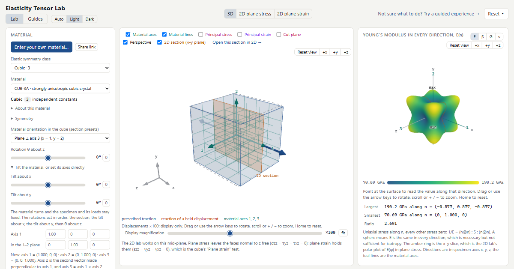

# SolidMechTools

Interactive tools for building physical intuition in solid mechanics.

> **Educational use only.** A personal project for exploring linear elasticity. The example materials are hypothetical and their values are illustrative. Nothing here is verified or intended for design, analysis, certification or any decision with real-world consequences. See [Disclaimer](#disclaimer).

## Elasticity Tensor Lab

**Try it: https://atababazadehnaseri.github.io/SolidMechTools/** (runs in the browser; best on a laptop or desktop)



A homogeneous specimen of a linear elastic material: a cube in 3D, where the
Lab opens, or a section in plane stress or plane strain. Material constants are
the controls; the stiffness and compliance matrices are read-only consequences.
Each component is either **traction-controlled** (stress prescribed) or
**displacement-controlled** (strain prescribed). This one switch moves the
specimen between a free test, which reads columns of S, and a fully constrained
test, which reads columns of C.

Also in the lab:
- principal stress and strain axes, and their misalignment;
- a cut plane with Mohr's circle;
- the stiffness eigenmodes (Kelvin modes);
- directional moduli and anisotropy indices;
- symmetry detection for the current constants;
- snapping knobs ("= E₁", "isotropic in the 1–2 plane", "0");
- example materials for all eight symmetry classes (see [Example materials](#example-materials)).

### 3D mode

The Lab opens in 3D, the first button of the mode switch. Each of the cube's six stress components is traction- or displacement-controlled. The 3D view shows:
- the deformed cube with its face tractions, split into normal and shear parts (prescribed in blue, reactions in orange);
- the same overlays as 2D: material axes, material lines, principal stress and strain axes, and a cut plane at any normal, with its traction t = σ·n and its point on the Mohr circles;
- the full 6×6 C and S, below the cube and the surface, where clicking an entry explains it and runs the one test that isolates it;
- surfaces over every direction for Young's modulus E(n), linear compressibility β(n), and the minimum and maximum over m ⟂ n of the shear modulus G(n, m) and Poisson's ratio ν(n, m), each of the two switchable, with extremes and a hover readout. The x–y slice of E(n) is drawn in amber: it is the 2D polar plot of E(φ) in plane stress;
- the stress and strain tensors, the principal stresses and strains in 3D, whether they are coaxial, and the three Mohr circles with the x, y and z faces;
- the six Kelvin modes of C, with their multiplicities, each of which can be applied to the cube;
- the 2D section (the x–y mid-plane) inside the cube, with a link back to 2D;
- the apparent stiffness along x.

In 2D and 3D the C and S band is open by default and can be folded away. Drag, or focus a view and use the arrow keys, to rotate it; scroll or + / − zooms. "Reset view" and +x, +y, +z restore the starting view or look along an axis, and "Perspective" switches both views between perspective and parallel projection. Besides θ about z, the material can be tilted about x and y, or its axes set directly from axis 1 and a vector in the 1–2 plane; in 2D a tilt moves the section plane. The 3D code (three.js) loads only when 3D is first opened. 2D data entered by the user has no 3D behaviour, so 3D and the tilts are disabled for it.

### Your own material

"Enter your own material…" loads your data in one of four forms:
- a 6×6 C or S matrix;
- symmetry-class constants;
- a 3×3 C̄ or S̄ declared as plane stress or plane strain;
- in-plane constants such as E₁, E₂, ν₁₂, G₁₂.

The material axes can be oriented anywhere in the specimen axes.

Pasted matrices take their units, component order (11, 22, 33, 23, 13, 12 or 11, 22, 33, 12, 13, 23) and shear convention (engineering, tensor or Mandel). Loading:
- refuses an asymmetric or unstable matrix, and says why;
- reports how far the matrix is from each symmetry class in your axes;
- offers the class it matches to within rounding, so its constants become knobs.

2D data drives every in-plane view; out-of-plane results stay greyed out because they need 3D constants.

The "other forms" panel gives the material in any notation and units, together with all its engineering constants. "Share link" encodes the material, its orientation, θ and mode in the URL.

Specification: [`docs/own-material.md`](docs/own-material.md). Data format: [`docs/material-format.md`](docs/material-format.md).

### Run

```bash
npm install
npm run dev        # http://localhost:5173
npm test           # mechanics verification suite
npm run build      # static site in dist/
```

### Layout

```
src/mechanics/   constitutive math only: no UI imports, unit-tested
  linalg.ts        small dense linear algebra (Cholesky, Gauss–Jordan, Jacobi)
  tensor.ts        Voigt/Mandel conventions, rotations built from R_M,ab = B_a : R B_b Rᵀ
  materials.ts     8 symmetry classes as engineering constants, 4 in-plane (2D) classes,
                   section planes, presets
  plane.ts         plane stress (S̄ = S[1,2,6]) and plane strain (C̄ = C[1,2,6]), mixed control,
                   directional moduli, coaxial directions
  principal.ts     principal values, tractions on a cut, Kelvin modes of C̄
  admissibility.ts positive definiteness, exact admissible interval of each knob
  anisotropy.ts    Voigt/Reuss, universal index A^U, E(n) extremes
  symmetry.ts      effective symmetry by invariance, matrix patterns
  snapping.ts      admissible snap targets for knobs
  projection.ts    nearest matrix of a symmetry class (group averaging), distance to each class
  orientation.ts   material axes from two vectors or from direction cosines
  solid.ts         the 3D cube: six-component mixed control, principal values
  constants.ts     apparent engineering constants, Kelvin moduli
src/app/         state, actions, experiments, derived quantities
  ownMaterial.ts   entered matrices and constants: units, notations, parsing, checks
  share.ts         the material format (docs/material-format.md) and share links
src/guides/      guided experiences: scripts over the same lab state, tested without the UI
src/ui/          React + SVG views; three.js for the 3D mode (ui/three/viewer.ts)
```

### Guides

The app opens in the **Lab**. The **Guides** tab holds eleven short guided experiences at three levels.
Each step sets up the specimen, shows only the panels it needs, and runs through up to five phases:
1. **Context**: what is on screen and what is fixed. It gives no instructions.
2. **Predict**: a multiple-choice question, asked only when the answer is not yet on screen. A reveal can hold back the load until the learner answers.
3. **Try**: instructions, the unlocked controls, and a task that is checked automatically, with a "Show me" fallback.
4. **Observe**: "what did you see?", asked once the task is done.
5. **Explain**.

Entering a step by any route (Next, Back, the step dots, Restart) rebuilds the state the step is written for. "Continue in the Lab" hands over the exact current state.

To add a guide:
1. Write a `Guide` object in `src/guides/`; the step format is documented in `src/guides/types.ts`.
2. Register it in `src/guides/index.ts`.
3. Add any numbers it quotes to `guides.test.ts`.

The tests walk every guide as a learner who presses "Show me", and they also jump straight to every step. They check that:
- each task starts unsolved, including before its prediction, and "Show me" solves it;
- each question has exactly one correct option;
- each number a guide quotes matches the engine.

`deferred/` keeps a guide whose out-of-plane steps wait for the 3D mode. It is not compiled.

### Conventions

- Voigt order 11, 22, 33, 23, 13, 12 with engineering shear strain. Rotations go
  through the Mandel form.
- Units: MPa internally; stiffness shown in GPa, compliance in TPa⁻¹.
- Engineering constants are defined from the lower Voigt index as the loaded
  direction: ν₁₂ = −ε₂/ε₁ under σ₁, η₁₂,₁ = γ₁₂/ε₁ under σ₁.
- Each knob holds the other constants of its class fixed. The compliance is then
  affine in 1/modulus or in the ratio, so the admissible range of each knob is
  an exact open interval (generalized eigenvalues of the knob direction against
  the current S).

### Example materials

The examples are hypothetical materials. Each name gives the symmetry class and the number of independent elastic constants, then a letter for its order within the class. For example, ISO-2A and ISO-2B are isotropic (2 constants), CUB-3A is cubic (3), and TRC-21A is triclinic (21). The others are HEX-5A, TET-6A, TRG-6A, ORT-9A, ORT-9B, MON-13A and MON-13B.

Their values are rounded and chosen to show a behaviour. They are not data for any real material and must not be used as such. Where an example is loosely based on published constants, the in-app section "About the example materials" cites the publication, for transparency only.

### Deployment

Every push to `main` runs the tests, builds the site and publishes `dist/` to
GitHub Pages (`.github/workflows/deploy.yml`). In the repository settings,
Pages → Source must be set to **GitHub Actions**.

### Status

Built with AI assistance (Claude). The mechanics is checked by an automated
test suite against analytical results and symmetry and invariance properties.
It has not been independently reviewed. Corrections are welcome via issues.

## Disclaimer

- This is a personal, educational project for self-directed exploration of linear elasticity. It is not a product or a service. It is not affiliated with, endorsed by or representative of any employer or organization.
- The software and its content are provided "as is", without warranty of any kind, express or implied, including of correctness or fitness for a particular purpose (see sections 11 and 12 of the [license](LICENSE)). The author accepts no responsibility or liability for any use of the software, its results or its content.
- The example materials are hypothetical. Their values are rounded and illustrative, and they are not the properties of any real material. Do not use anything here as a source of material data.
- Results come from idealized, homogeneous, small-strain linear elasticity. They are not checked for engineering design, analysis, certification, safety assessment or any decision with real-world consequences, and must not be used for them. Those need validated tools, measured data and qualified professional judgement.
- The guides and explanations are teaching material. They may simplify, and they may contain errors.

## Privacy

The app has no analytics, no cookies and no accounts, and it makes no network requests of its own. Everything is computed in the browser.

A share link carries its material in the part of the URL after "#", which browsers do not send to the server. The site is hosted on GitHub Pages, which may keep its own server logs. The theme choice and the list of completed guides are kept only in the browser's local storage.

## License

GPL-2.0 (see [LICENSE](LICENSE)). The bundled third-party packages and their licenses are listed in [THIRD_PARTY_NOTICES.md](THIRD_PARTY_NOTICES.md).
